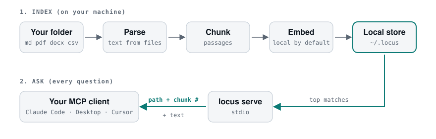

<p align="center">
<picture>
<source media="(prefers-color-scheme: dark)" srcset="docs/assets/wordmark-dark.svg">

</picture>
</p>

**Ask your AI assistant about your own files. Every answer names the file it came from.**

[](https://pypi.org/project/locusfiles/)   

Locus indexes folders you choose on your own computer and gives your MCP client (Claude Code, Claude
Desktop, Cursor and others) a search tool over them. Indexing and embeddings can run entirely on
your machine; the excerpts your assistant retrieves go to the assistant you chose, like text you
pasted in. Locus is **source-available** under FSL-1.1-ALv2, not open source (see [Licence](#licence)).

## Try it on the demo folder

```text
$ uv tool install --python 3.12 "locusfiles[local]"   # about 530 MB on disk, no account, no API key
$ locus index tests/fixtures/demo-vault               # from a clone of this repository
seen=21 indexed=21 skipped=0 removed=0 chunks=22 errors=0

$ locus query "why did the annual discount change from two months free, and what is the new Solo annual price" -k 4
1. [0.725] meetings/2026-08-19-pricing-review.md #0
2. [0.724] pricing/pricing-v3.md #0
3. [0.710] pricing/pricing-v1.md #0
4. [0.653] research/survey-results.csv #0
```

(Paths shortened; the real output also prints a text preview under each result.) The folder is a small
fictional company: 21 files (markdown, PDF, DOCX, CSV, text). The question needs three files from three
folders. They say: a beta survey asked for a bigger discount, the 2026-08-19 review replaced "two months
free" with a flat 25%, and Solo annual went from $60 to $54. Your assistant gets the same chunks through
the MCP tool, with the path and chunk number, so it can cite them.

Connect Claude Code, then ask it "Using Locus, why did the annual discount change?":

```bash
locus doctor        # every line should say OK
claude mcp add --scope user locus -- "$(command -v locus)" serve
```

Run `/mcp` inside Claude Code: `locus` should show Connected. If it fails, run `locus doctor` and fix
any FAIL line.

## Install

`uv` installs its own Python, so you do not need one first. `pipx install "locusfiles[local]"` works
if you already have Python 3.11 or newer. To run the server without installing it:
`uvx --from "locusfiles[local]" locusfiles serve` (`locusfiles` is an alias of `locus`).

The `local` extra runs the embedding model with ONNX Runtime. The default model is
`intfloat/multilingual-e5-small` (MIT licence, about 100 languages): the whole environment is about
400 MB plus a 134 MB model that downloads on first use (the earlier PyTorch route was 1.1 GB plus a 133 MB
model). Measured on one Apple-silicon Mac with a fast network and a cold package cache: about 15 s to install,
about 33 s for the first `locus doctor` including the model download, about 4 s to index the demo folder
and about 2.6 s per `locus query` from the command line. Slower networks take longer.

PyTorch is optional: `locusfiles[local-torch]` is for models the default route lacks
(`bge-m3`, `multilingual-e5-base` and larger, model folders). `LOCUS_LOCAL_MODEL=BAAI/bge-m3` is the
most accurate choice for Hebrew and mixed-language files, at a 2.3 GB download. To embed with your own provider key instead, use the
`voyage` or `openai` extra and set `LOCUS_EMBEDDER`. `locus setup --local` picks the embedder and
prints the `claude mcp add` line with your settings filled in.

macOS and Linux are tested. Windows is not verified yet.

## Connect your assistant

- Claude Code: the `claude mcp add` line above ([details](src/locus/support_kb/connect-claude-code.md)).
- Claude Desktop: [setup](src/locus/support_kb/connect-claude-desktop.md).
- Cursor: [setup](src/locus/support_kb/connect-cursor.md).
- Other MCP clients that can start a local server: [guide](src/locus/support_kb/other-ai-apps.md).

Locus exposes three tools: `locus_search`, `locus_list_sources` and `locus_read_file`. Every result
carries a file path and a chunk number. `locus_read_file` only reads files that are already in the
index.

## How it works

<picture>
<source media="(prefers-color-scheme: dark)" srcset="docs/assets/architecture-dark.svg">

</picture>

Your raw files are never copied into `~/.locus`: only chunk text, vectors and metadata. Re-run
`locus index <folder> --prune` after changes (unchanged files are skipped), or use
`locus watch <folder>` to keep the index current.

## What leaves your computer

- Indexing and embeddings with the `local` extra run on your machine. The first run downloads the
  embedding model from Hugging Face (the model only; none of your files or text).
- Search results (chunk text and file excerpts) go to the assistant and model you use, by design.
  That is the feature, and it is the same as pasting the text into that assistant.
- With `voyage` or `openai`, chunk text goes from your computer to that provider under your own key.
- Raw files are not uploaded by Locus.

## File types

Markdown, text, code, CSV, HTML, PDF, DOCX, PPTX, XLSX, ODS, ODT, RTF, EPUB, IPYNB and subtitle files.
Hidden files such as `.env` and some config file types are skipped by default.

## Status and what we measured

Early. The numbers below are small samples on the maintainer's own folder (20 questions), scored by the
maintainer's own tooling and not by an independent reader:

- With the assistant told to use Locus: 10 of 10 English questions answered correctly with file
  citations (95% interval 72% to 100%).
- Left to choose in a chat app: Locus was called on 4 of 10 questions; 5 of 10 were answered
  correctly (interval 24% to 76%). When it was called, 4 of 4; when it was not, 1 of 6.
- Hebrew questions in chat: 1 of 5. (These three chat numbers were measured with the previous default
  model, which was English-only.)
- Offline retrieval, question as written: the right file ranked in the top 5 for 10 of 17 scored questions
  (also with the previous model).

On a public test, paired English and Hebrew (Belebele: the same 900 questions in both languages, 488 passages
each, scored as the right passage in the top 5), the previous model found the right passage for 95.0% of
English and 12.9% of Hebrew questions. The current default finds it for 97.2% and 89.7%: a gap of 7.6 points
(95% interval 5.5 to 9.6, resampling whole passages). That is under the 10-point margin I set in advance and
not under 5 points; larger models do better (`bge-m3`: gap 3.3). It is short Wikipedia-style passages, not
your files, and it measures search only, not whether the assistant calls Locus. I will publish the per-question
results and the scripts with the benchmark write-up.

A reproducible benchmark on public documents will replace these numbers.

## Limits

- Languages. On the same public test in 12 other languages (Arabic, Russian, Chinese, Japanese, Spanish,
  Hindi, German, French, Turkish, Korean, Thai, Swahili) the default model finds the right passage in the top
  5 for 88% to 96% of questions (average 93%; the previous model averaged 40%). Its gap to English is under
  10 points in 11 of the 12 (95% interval); Swahili is not: 9.2 points behind, interval 6.9 to 11.5. Those 12
  runs used the full-precision file of the model; the smaller file that ships was checked on English and Hebrew
  only, and on Locus's own code path it gave the same results within 0.4 points. `bge-m3` was within 10 points
  in all 12.
- Searching in one language over files in another is weaker. With the default model an English question finds
  the right Hebrew passage in the top 5 for 83% of questions and a Hebrew question finds the right English
  passage for 71% (same language: 97% and 90%). With `bge-m3`: 94% and 91%.
- Assistants do not always call Locus by themselves. If yours answers from memory, say "search my files
  with Locus".
- Not a replacement for a full desktop search app, and it does not read your email, calendar or the web.
- Issues are welcome. Pull requests are not accepted yet while a contributor agreement is prepared.

## Licence

Functional Source License 1.1 with an Apache-2.0 future licence (`FSL-1.1-ALv2`), for the whole
repository. You may use, copy, modify and redistribute it for any purpose except a Competing Use:
making it available to others in a commercial product or service that substitutes for it or offers
substantially similar functionality.

Each version becomes available under Apache-2.0 two years after it was released.
Text: [LICENSE](LICENSE). Plain-language answers: [LICENSE-FAQ.md](LICENSE-FAQ.md).
Security reports: [SECURITY.md](SECURITY.md).
