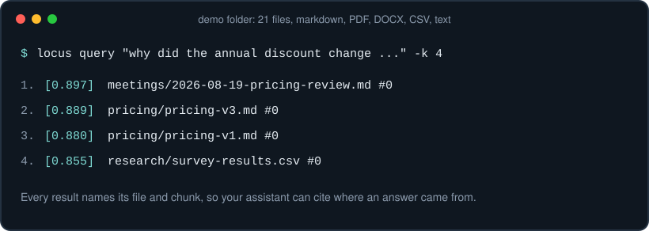
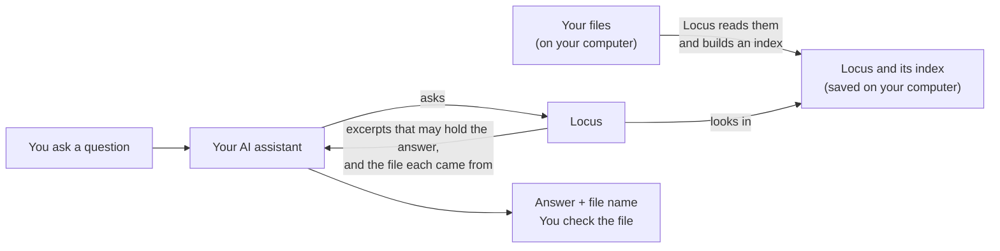
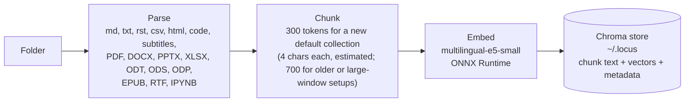
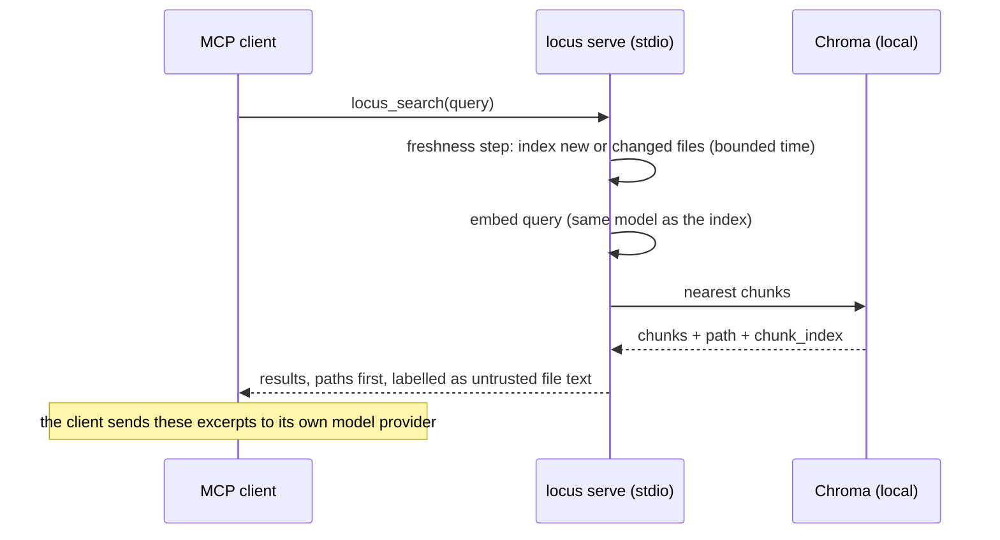

<p align="center">
<picture>
<source media="(prefers-color-scheme: dark)" srcset="docs/assets/wordmark-dark.svg">

</picture>
</p>

<h1 align="center">Ask your AI assistant about your own files</h1>

<p align="center"><strong>Search results name the file they came from.</strong><br>
A local-first MCP server: it indexes folders you choose on your own computer and gives MCP clients that can start a local server a search tool over them.</p>

<p align="center">
<a href="https://pypi.org/project/locusfiles/"></a>

<a href="#licence"></a>
<a href="https://github.com/yonilev2003/locusfiles/actions/workflows/ci.yml"></a>

</p>

<p align="center">
<a href="#quick-start">Quick start</a> &middot; <a href="#works-with">Works with</a> &middot; <a href="#what-leaves-your-computer">Privacy</a> &middot; <a href="#faq">FAQ</a> &middot; <a href="#licence">Licence</a>
</p>

<p align="center">

</p>

## Quick start

```bash
uv tool install --python 3.12 --prerelease allow "locusfiles[local]==0.2.0rc2"   # about 530 MB, no account, no API key
locus doctor                                  # every line should say OK; the first run asks one question about commercial use
locus index ~/Documents/notes                 # start with a small folder; `locus estimate <folder>` shows the size first
claude mcp add --scope user locus -- "$(command -v locus)" serve
```

Then ask Claude Code: *"Using Locus, what did I decide about pricing?"* Each search result carries the file path and
the chunk number, so your assistant can cite where an answer came from. Other assistants:
[Works with](#works-with). Try it first on the bundled [demo folder](#try-it-on-the-demo-folder).

## Why Locus

- **It finds the right files, not just matching words.** Semantic search across the folders you choose; the default
  on-device model covers about 100 languages.
- **Every result names its source:** a path and a chunk number, so an answer can point back to the file.
- **Local-first.** Indexing and embeddings run on your computer, with no account and no API key by default. The
  excerpts your assistant retrieves go to the assistant you chose, like text you pasted in.
- **Controls you can check:** `~/Downloads` stays closed until you open it on purpose, `locus pause` stops the
  file tools at once, and an audit log records paths and counts, never file text.
- **Three ways in:** MCP over stdio, a command line with `--json`, and a local HTTP API.

## Works with

Any MCP client that can start a local server. `locus setup --client NAME` writes or prints the configuration.
"Tested" means the project ran it, not that the vendor supports it.

| Assistant | Command | Tested by Locus |
|---|---|---|
| Claude Code | `locus setup --client claude-code` | recorded run on 0.2.0 (2026-11-14, macOS) |
| Claude Desktop | `locus setup --client claude-desktop` | older record only (pre-release, 2026-09-16) |
| Cursor | `locus setup --client cursor` | older record only (pre-release, 2026-09-16) |
| Codex, Copilot CLI | `locus setup --client codex`, `locus setup --client copilot` | earlier engine only (0.1.0, 2026-10-01) |
| Gemini CLI, Windsurf, LM Studio | `locus setup --list` | not tested |

claude.ai and ChatGPT need a remote server with sign-in, which this release does not include
(see [Web and phone assistants](#web-and-phone-assistants-claudeai-chatgpt-cloud-agents)).

## What it is, and what it costs

Locus indexes folders you choose on your own computer and gives MCP clients that can start a local
server a search tool over them (setup pages exist for Claude Code, Claude Desktop and Cursor, and only Claude
Code has a recorded run on this version). Indexing and embeddings can run entirely on
your machine; the excerpts your assistant retrieves go to the assistant you chose, like text you
pasted in. Locus is **source-available** under the PolyForm Noncommercial License 1.0.0: free for noncommercial
use (personal, educational, charitable and public-body use). The licensor reads that as excluding **work at a
company, paid client work, and use inside a product or service** (see [Licence](#licence) and
[LICENSE-FAQ.md](LICENSE-FAQ.md)). It is not open source.

## Which user are you?

Locus lets an AI assistant look through folders you choose; each search result names the file it came from. Pick
the description that fits you; each one stands alone. The demo, install and licence sections below are for
everyone.

<details>
<summary><strong>Everyday user (not technical)</strong></summary>

**Locus helps your AI assistant find things in your own files.**

You keep documents on your computer: letters, contracts, notes, reports. Finding one fact in them takes time.

Locus reads the folders you choose. It builds an index, like the index at the back of a book. The index is saved
on your computer.

You ask your AI assistant a question about your files. The assistant asks Locus. Locus looks in the index and
sends back short excerpts that may hold the answer. Each excerpt names the file it came from.

The assistant reads the excerpts and answers. Check the answer against the file. Locus can return the wrong
passage, and the assistant can misread it.



**What Locus does**

- It looks at the folders you choose. It does not change or delete your files. It keeps its own index in its own
  folder. (Not fully verified: we read the code behind its tools, not every line of the program.)
- It names the file for every excerpt.
- It reads text: documents, notes, spreadsheets, slides, and PDFs that contain real text.
- It checks for new and changed files when you ask a question, within a short time limit. On a very large folder
  this can take a few questions.

**What Locus does not do**

- It does not read scans or photos. A scanned page is a picture to Locus, and it has no text recognition.
- It searches the folders you choose. It does not search the web, email or a calendar.
- It is not always right. It can miss a file or return the wrong one.

**Where things go**

- The index stays on your computer. It is a readable copy of the text of your files, not encrypted. Anyone who can
  open your user folder can read it.
- The excerpts Locus returns go to your AI assistant, and on to the company that runs it, usually over the
  internet.
- The first time you use it, Locus downloads a search model (134 MB) from Hugging Face.

Setting it up today means typing a few commands in a terminal (see the demo below); there is no installer yet.
If your assistant answers from memory, ask it to "search my files with Locus".

</details>

<details>
<summary><strong>Engineer or data scientist</strong></summary>

Locus is a local MCP server. It indexes folders you choose and exposes semantic search over them to MCP clients
that can start a local server over stdio. Every result carries a file path and a chunk number. Setup pages for
Claude Code, Claude Desktop and Cursor are in the repository; on this version we have tested Claude Code only. We
publish no measurement of how any assistant behaves with it.

### Pipeline





The parse list is the default extension list in `src/locus/config.py` (`DEFAULT_EXTENSIONS`) and the readers in
`src/locus/ingest/parsers.py`.

### What leaves the machine

- In the default mode indexing and embedding run locally. The first run downloads the model from Hugging Face.
- **The excerpts a search returns go to the MCP client and on to that client's model provider.** That is the
  feature. Locus does not upload raw files.
- The index is a readable, unencrypted local copy of the chunk text in `~/.locus`. The code sets the folder to mode
  0700 on macOS and Linux (`store.py`; tried once on a scratch folder, not checked on a live install); Windows is
  not verified.
- Hosted modes and Notion sync refuse to run unless `LOCUS_ENABLE_HOSTED=1` or `LOCUS_ENABLE_NOTION=1`. Read from
  the source on 2026-11-14 in an AI-assisted review run by us; **no independent audit**.
- The library that runs the embedding model (ONNX Runtime 1.31 and later) has its own usage telemetry on macOS and
  Linux; Locus switches it off. Details, and what was and was not verified, are under "What leaves your computer".

### Facts you can check

- **Tools.** Five are always listed: `locus_search`, `locus_list_sources`, `locus_read_file`, `locus_help`,
  `locus_diagnose_connection`. A sixth, `locus_account_status`, exists only when `LOCUS_API_KEY` is set.
- **File access.** `locus_read_file` reads only paths already in the index. In our own scripted self-check (a real
  MCP client over stdio, 2026-11-15), 13 attempts to read other paths were refused and none returned file content.
  Not an independent test.
- **What the tools write.** All six tools carry the MCP read-only annotation. That is a hint to the client, not
  enforcement. `locus_search` and `locus_list_sources` run an index-on-demand step before answering, which can add,
  update and remove rows in Locus's own index and write small state files in the data folder;
  `locus_diagnose_connection` creates and deletes a temporary file there. We found no code path in the tools that
  writes to an indexed file. A full line-by-line audit was not done. **Not verified:** that nothing else ever
  modifies a user file.
- **One model per collection.** The embedder name is stored in the collection metadata. Switching models means a new
  collection.
- **Default model.** `intfloat/multilingual-e5-small` through ONNX Runtime: about 400 MB of environment plus a
  134 MB model downloaded on first use, stored in `~/.cache/locus/onnx`, outside `~/.locus`.
- **Chunk size.** A new collection made with the default model uses 300 "tokens" per chunk (an estimate of about 4
  characters per token, not the model's tokenizer). 700 applies to collections made before 0.1.4, to a model with a
  large window (`bge-m3`) or a hosted provider, and when `LOCUS_CHUNK_TOKENS=700` is set; `locus index --dry-run`
  says which size a collection will use. The benchmark below ranks whole passages, not Locus's chunks.
- **Not read.** PDFs averaging under 20 characters per page are treated as scans and skipped. There is no OCR.
  Images are not indexed.
- **Text layers only.** Formulas and tables in PDFs can be dropped or scrambled by text extraction (seen in spot
  checks; not measured).
- **Index freshness.** Before `locus_search` and `locus_list_sources` answer, a bounded step (2 seconds by default)
  indexes new and changed files. On a very large folder it may take several calls, and removed files are cleaned up
  fully with `locus index <folder> --prune`. Read in the code, tested live.

### Retrieval quality, measured (retrieval only, public passages)

**Label: retrieval only, public passages.** Source: our own benchmark on the public Belebele set (the same 900
questions in every language, 488 passages; per-question result files and a statistics file, not yet published).
Scored as "the right passage is in the top 5" (recall@5). Short Wikipedia-style text, not your files; search only,
not a final answer. Run by us; not replicated by anyone else.

| Model (shipped default in bold) | English | Hebrew | Gap, EN minus HE (95% interval, cluster bootstrap) |
|---|---|---|---|
| bge-small-en-v1.5 (previous default) | 95.0% | 12.9% | 82.1 pts [79.0, 85.1] |
| **multilingual-e5-small** (full-precision file; the int8 file that ships: 96.9% and 89.7%) | **97.2%** | **89.7%** | **7.6 pts [5.5, 9.6]** |
| bge-m3 (optional, about 2.3 GB download) | 98.3% | 95.0% | 3.3 pts [2.1, 4.7] |

- Gaps are computed from unrounded values (97.22 minus 89.67 = 7.56). The 10-point margin was set before the
  runs; the default is under it and not under 5 points.
- Indicative Wilson 95% intervals for single recalls, computed from the per-question counts (they ignore that
  questions share passages, so they are slightly too narrow): default EN 95.9 to 98.1, default HE 87.5 to 91.5,
  bge-m3 HE 93.4 to 96.2, bge-small HE 10.9 to 15.2.
- 12 other languages, the same 900 questions translated: default 88.0% to 95.8% (mean 93.4%); previous default 4.8%
  to 77.2% (mean 40.1%). These 12 are not independent samples. The 10-point test is on the upper end of the gap's
  95% interval: for the default it is under 10 points in 11 of the 12; Swahili is the exception (gap 9.2, interval
  6.9 to 11.5, so not shown to be under 10). For `bge-m3` the upper end is under 10 in all 12. Those runs used the
  full-precision file of the model; the smaller file that ships was checked on English and Hebrew only, where its
  recall@5 differed from full precision by at most 0.33 points (at top-1 by up to 0.78, in Hebrew).
- At top-1 the English-to-Hebrew gap of the default is larger: 11.6 pts [9.0, 14.1].
- Across languages (a question in one language, passages in the other): default EN to HE 83.4%, HE to EN 71.1%;
  bge-m3 94.3% and 91.2%. No intervals computed. Searching in one language over files in another is weaker than
  searching in the same language.
- Volume: 65,700 per-question rows in 73 files for the model runs, plus 17,100 rows in 19 files for the BM25
  baseline below, from the same 900 questions per language re-run across models, variants, languages and a keyword
  baseline. **Not** that many independent tests.
- On the same public Belebele benchmark (900 questions per language, recall@5, retrieval only), a basic BM25
  keyword baseline scored 91.9% in English and 86.0% in Hebrew (with a simple Hebrew prefix-stripping heuristic),
  against 97.2% and 89.7% for the default model (full-precision file): differences of +5.3 pts [+3.3, +7.4] and +3.7 pts [+1.1, +6.2]
  (cluster bootstrap, 95%). This says nothing about your own files, and no hybrid (keyword plus embeddings) was
  tested.
- **Not tested:** search over a real folder of thousands of chunks, so these numbers do not transfer to scale or to
  your files; latency and index size at scale; whether an assistant's final answer is correct. We publish no figure
  for how often assistants choose to call Locus or for how good their final answers are.

### Limits worth knowing

- macOS (Apple silicon) was tested on one machine in a clean-install run on 2026-11-15. On Linux (arm64, Debian 13)
  the test suite (no failures, 8 tests skipped; it needs `procps` and a raised open-file limit) and a clean
  install of the wheel passed inside a container on 2026-11-17, one run: not a real Linux machine, not x86_64, and
  no assistant was tried there. Windows is not verified by us.
- A file can contain text written to steer an assistant. Locus labels results as untrusted file content. That is a
  request to the model, not a barrier.
- The default model was chosen among 8 settings on the same dataset it is reported on, so its benchmark numbers are
  somewhat optimistic.

A document with the method, statistics and limits will be published with the benchmark.

</details>

<details>
<summary><strong>Businessperson</strong></summary>

**What it is.** Locus lets your AI assistant search your own documents; each search result names the file it came
from.

**The problem it solves.** Teams keep knowledge in folders: contracts, notes, reports. An assistant that cannot see
them guesses. An assistant that can search them can quote them. Locus is the part that looks for the passages that
probably hold the answer. It can miss, and it can return the wrong passage.

**What you get.**

- Results that name the file, so a person can check. Whether the assistant uses them correctly is up to the
  assistant.
- Search and indexing that can run fully on your own computer. The first run downloads a search model from
  Hugging Face.
- Connection to assistants through MCP, a common standard for connecting tools to AI assistants. Setup is shown for
  Claude Code below; setup pages for Claude Desktop and Cursor are in the repository. On this version we have tested
  Claude Code only, and we publish no measurement of how any assistant behaves with Locus.

**What leaves your computer.**

- By default, the excerpts your assistant asks for go to that assistant and its provider, the same as if you had
  pasted them in. Locus does not upload your raw files.
- Locus keeps a readable, unencrypted copy of the text of your files (cut into pieces) in a folder on your
  computer. Anyone who can read that folder can read the text. Use disk encryption and keep the folder out of
  cloud-sync folders.
- Locus offers no hosted service in this version. The earlier hosted relay (managed embeddings and the remote
  connection) is off by default (`LOCUS_ENABLE_HOSTED=1`) and still in testing, and Notion sync is off unless you
  turn it on.

**Who may use it.** Summary, not legal advice. The binding text is the [LICENSE](LICENSE) file.

- The licence (PolyForm Noncommercial 1.0.0) permits any noncommercial purpose. Its text names two groups.
  Personal use: research, experiment and testing for the benefit of public knowledge, personal study, private
  entertainment, hobby projects, amateur pursuits or religious observance, without any anticipated commercial
  application. And use by a charitable organisation, educational institution, public research organisation, public
  safety or health organisation, environmental protection organisation or government institution, whatever its
  funding.
- The licence text does not define "commercial". The licensor's own reading, in [LICENSE-FAQ.md](LICENSE-FAQ.md)
  (not part of the licence text), is that work for a company, paid client work, and use inside a product or service
  count as commercial, including for one person. If you are not sure, treat it as commercial and ask.
- **Commercial use needs a separate paid licence. None can be bought yet: join the waitlist at
  <https://locusfiles.com/commercial>.**
- The code is source-available. It is not open source, because the licence limits use to noncommercial purposes.
- Releases 0.1.x were released under FSL-1.1-ALv2 and stay under it.
- Other terms: redistribution must keep the licence text and the Required Notice line; no sublicensing; a patent
  clause; 32 days to fix a violation after written notice; no warranty. Read LICENSE.

**How good is it, in plain words.**

- Label: **retrieval only, public passages.** On a public set of 900 questions, which we ran ourselves and nobody
  has repeated, the default search puts the right passage among the first five results for about 97% of English
  questions and about 90% of Hebrew ones. That measures search only, not whether an assistant's final answer is
  correct.
- Same label and source: in 12 other languages, between 88% and 96%.
- That test uses short public texts, not your documents. With your documents, results can be better or worse.
- We publish no figure for how often assistants choose to call Locus or for how good their final answers are.

**What it cannot do (today).**

- It does not read scanned pages or photos.
- It does not search email, a calendar or the web.
- Locus checks for new and changed files when your assistant searches, within a short time limit. On a very large
  folder this can take several searches.

**Status.** Early software. No independent security audit: the data-flow statements come from our own AI-assisted
reading of the source on 2026-11-14. Linux was tried inside a container (the tests and a clean install,
2026-11-17) and on GitHub's Ubuntu runner (the install-to-answer journey, 2026-11-18). On GitHub's Windows runner the same journey passed once (2026-11-18), but about 200 of the repository's own tests fail on Windows and have not been sorted yet, so Windows is not verified as supported.

</details>

## Try it on the demo folder

```text
$ uv tool install --python 3.12 "locusfiles[local] @ git+https://github.com/yonilev2003/locusfiles@v0.2.0rc2"
                                                      # about 530 MB on disk, no account, no API key
$ locus index tests/fixtures/demo-vault               # from a clone of this repository
seen=21 indexed=21 skipped=0 removed=0 chunks=22 errors=0

$ locus query "why did the annual discount change from two months free, and what is the new Solo annual price" -k 4
1. [0.897] meetings/2026-08-19-pricing-review.md #0
2. [0.889] pricing/pricing-v3.md #0
3. [0.880] pricing/pricing-v1.md #0
4. [0.855] research/survey-results.csv #0
```

(Paths shortened; the real output also prints a text preview under each result.) The folder is a small
fictional company: 21 files (markdown, PDF, DOCX, CSV, text). The question needs three files from three
folders. They say: a beta survey asked for a bigger discount, the 2026-08-19 review replaced "two months
free" with a flat 25%, and Solo annual went from $60 to $54. Your assistant gets the same chunks through
the MCP tool, with the path and chunk number, so it can cite them.

Connect Claude Code, then ask it "Using Locus, why did the annual discount change?":

```bash
locus doctor        # every line should say OK; the first run asks one question about commercial use (see Licence)
claude mcp add --scope user locus -- "$(command -v locus)" serve
```

Run `/mcp` inside Claude Code: `locus` should show Connected. If it fails, run `locus doctor` and fix
any FAIL line.

## Install

`uv` installs its own Python, so you do not need one first. `0.2.0rc2` is a pre-release on PyPI and the PyPI default
is still the older 0.1.4, so name the version:
`uv tool install --python 3.12 --prerelease allow "locusfiles[local]==0.2.0rc2"`. To install from this repository
instead, the commands name the release tag `@v0.2.0rc2`, so you get that release and not whatever the default branch
holds later (`pipx install "locusfiles[local] @ git+https://github.com/yonilev2003/locusfiles@v0.2.0rc2"` works if you
already have Python 3.11 or newer). To run the server without installing it:
`uvx --from "locusfiles[local] @ git+https://github.com/yonilev2003/locusfiles@v0.2.0rc2" locusfiles serve`
(`locusfiles` is an alias of `locus`).

The `local` extra runs the embedding model with ONNX Runtime. The default model is
`intfloat/multilingual-e5-small` (MIT licence, about 100 languages): the whole environment is about
400 MB plus a 134 MB model that downloads on first use (the earlier PyTorch route was 1.1 GB plus a 133 MB
model). Measured once on 2026-11-18 on one Apple-silicon Mac, with a cold package cache and no cached model (power source not
recorded): about 33 s to install from PyPI, about 95 s for the first `locus doctor` including the 134 MB model
download, and about 15 s to index 28 markdown files (117 chunks), which is about 8 chunks per second including
start-up. A folder of 1,000 chunks therefore takes about two minutes and a large folder takes much longer, so run
`locus estimate <folder>` first and start with a small folder. On GitHub's Ubuntu runner (x86_64) the same journey,
install to MCP answer, took about 30 s in one run the same day. An earlier 7-run measurement put each `locus query`
from the command line at 3.5 to 4.4 s, because the model loads on every call. These are single measurements. Slower
networks take longer: the download is about 530 MB.

PyTorch is optional: `locusfiles[local-torch]` is for local models that fastembed does not list (checked against
fastembed 0.9.1 on 2026-11-17): `BAAI/bge-m3`, `intfloat/multilingual-e5-base` and local model folders; the default
`multilingual-e5-small` (which Locus adds itself) and `multilingual-e5-large` use the default route.
`LOCUS_LOCAL_MODEL=BAAI/bge-m3` scored higher on Hebrew than the default in our benchmark (95.0% against 89.7%,
recall@5, measured through ONNX Runtime, while Locus runs it through PyTorch), at a 2.3 GB download; mixed-language
files were not tested. To embed with your own provider key instead, use the
`voyage` or `openai` extra and set `LOCUS_EMBEDDER`. `locus setup --local` picks the embedder and
prints the `claude mcp add` line with your settings filled in.

Tested on one Mac (Apple silicon, macOS). On Linux (arm64, Debian 13), the test suite (no failures, 8 tests skipped)
and a clean install of the wheel passed inside a container on 2026-11-17 (one run; running the suite needs `procps`
and more open files than a container's default of 1024). That is not a real Linux machine, not x86_64, and no
assistant was tried there. Windows is not verified.

## Connect your assistant

- Claude Code: the `claude mcp add` line above ([details](src/locus/support_kb/connect-claude-code.md)).
- Claude Desktop: [setup](src/locus/support_kb/connect-claude-desktop.md).
- Cursor: [setup](src/locus/support_kb/connect-cursor.md).
- Other MCP clients that can start a local server: [guide](src/locus/support_kb/other-ai-apps.md).

On this version we have a recorded run with Claude Code only: automated Claude Code sub-agents on one Mac on
2026-11-14, a handful of runs, not an interactive session. The Claude Desktop and Cursor pages are written but not
tested on this version, and we make no claim about any other client.

`locus setup --list` shows the clients that `locus setup --client NAME` knows. By default it only prints the
configuration for that client and where it goes; `--write` adds the `locus` entry to the client's own config file,
after asking and with a backup of the file first. Setup writes a configuration. It does not mean Locus has been
tested with that client.

### Without an MCP client

Anything that can run a command or make a web request can use the same index, with the same folder rules as the MCP
tools. `locus query "..." --json`, `locus sources --json` and `locus read PATH --json` print JSON with a file path
and chunk number on every result and use stable exit codes. `locus api` starts a small web server on your own
computer (OpenAPI 3.1 description, a token you choose, Host and Origin checks, a rate limit, and a log of which
paths were returned, never the text): see [docs/api.md](docs/api.md). Every result is an excerpt of your files and
goes to whatever program asked for it.

### Web and phone assistants (claude.ai, ChatGPT, cloud agents)

These cannot start a program on your computer, and Locus offers no hosted service for them in this version: the
earlier relay is off by default (`LOCUS_ENABLE_HOSTED=1`) and still in testing (see "What leaves your computer"). Claude.ai and ChatGPT ask
for a kind of sign-in (OAuth) that Locus 0.2.0 does not have, so they are not supported yet. For a client that
accepts a fixed token, [docs/remote-tunnel.md](docs/remote-tunnel.md) describes how to put `locus serve
--transport streamable-http` behind a tunnel you run yourself (`locus doctor --remote URL` checks it). Nothing in
that guide has been tried with a real client yet, and whoever runs the tunnel carries your traffic.

The three file tools are `locus_search`, `locus_list_sources` and `locus_read_file`. Every result
carries a file path and a chunk number. `locus_read_file` only reads files that are already in the
index. Two more tools never read your files: `locus_help` (help articles bundled with the package, works
offline) and `locus_diagnose_connection` (checks your setup; it contacts Locus's servers only if asked to with
`check_remote`). A sixth tool, `locus_account_status`, is registered only when `LOCUS_API_KEY` is set, that is,
only for someone who uses a Locus account (off by default, see below); without a key the server lists five
tools and its instructions do not mention it. Every tool carries the MCP read-only hint. That is a hint to the
client, not enforcement: `locus_search` and `locus_list_sources` first update Locus's own index (new and changed
files) before they answer. We found no code path in the tools that writes to a file you indexed; that was a code
search, not a full audit.

## How it works

<picture>
<source media="(prefers-color-scheme: dark)" srcset="docs/assets/architecture-dark.svg">

</picture>

Locus does not copy your files into `~/.locus`: it stores chunk text, vectors and metadata. (One exception, off by
default: `locus sync-notion` writes each Notion page it pulls as a plaintext Markdown file there.) Re-run
`locus index <folder> --prune` after changes (unchanged files are skipped; `--prune` also removes the index
entries of files that no longer exist or that the deny-list below now refuses), or use `locus watch <folder>` to
keep the index current. Without either, `locus_search` and `locus_list_sources` run a short freshness step before
they answer (2 seconds by default) that indexes new and changed files; on a very large folder it can take several
calls to catch up, and only `--prune` fully removes the entries of deleted files. Read in the code, not tested
live.

## Your data on disk, and how to erase it

`~/.locus` (or the folder `LOCUS_DATA_DIR` names; `%USERPROFILE%\.locus` on Windows) holds the index. **The index
is readable text:** it stores the text of every chunk Locus cut from your files, next to the vectors, in a local
Chroma database. Locus does not encrypt it. Anyone or anything that can read that folder (another program running
as you, a backup, a synced or shared drive that includes it) can read those chunks. Use your system's disk
encryption (FileVault, BitLocker, LUKS) and keep the folder out of cloud-sync and shared folders. On macOS and
Linux the code sets the folder to readable by your account only (mode 0700; tried once on a scratch folder, not
checked on a live install); Windows is not verified. The same folder may also hold your policy file (`policy.toml`,
once you have a rule or an opened folder), the audit log (`audit/`), the pause flag (`PAUSED`), the answer to the
first-run licence question (`licence-ack`), a note that the one-time upgrade check for closed folders has run
(`closed-folders.json`), a random
8-character computer tag (`device_id`, only if you used the remote connection) and, if you used `locus sync-notion`,
your Notion access token (`notion_token.json`) and the pages as plaintext Markdown files (`sources/notion/`).

To erase what Locus keeps on this computer:

1. Quit your AI app, and stop any `locus serve` or `locus watch` that is running.
2. Delete the folder: `rm -rf ~/.locus` (your `LOCUS_DATA_DIR`, if you set one). That does not remove the downloaded
   embedding model, which is kept apart in `~/.cache/locus/onnx` (or the folder `FASTEMBED_CACHE_PATH` names): delete
   it too if you want it gone (it is a public model, not your data).
3. Delete any `.env` file you made with `locus setup` (it can hold an API key), remove the Locus entry from your
   AI app's MCP settings, then `uv tool uninstall locusfiles` (or `pipx uninstall locusfiles`).

Deleting the folder does not reach: excerpts your assistant already received (they stay in that app's
conversation history; delete those chats there); text already sent to a provider you used (Voyage, OpenAI or
Locus's hosted relay, whose own policies apply); copies in backups, snapshots (for example Time Machine) and
synced folders; and a normal delete is not a secure wipe on an SSD. If you used Notion sync, also remove the
integration's access in your Notion settings. There is no "forget one folder" command yet: to stop searching a
folder, start a new collection (`LOCUS_COLLECTION`) and index only the folders you want.

## What leaves your computer

Checked against the code of version 0.2.0 on 2026-11-14, by reading the source; the ONNX Runtime entry below was
added after a separate test on 2026-11-15. Locus's own code contains no analytics and no usage reporting; the
requests it can make are the ones below, and one library it uses has telemetry of its own (see the ONNX Runtime
entry). It is not independently audited.
Which of them happen depends on the mode you set (`LOCUS_EMBEDDER`, and the commands you run); the default is
`local`. **Locus's hosted modes (managed embeddings and the remote connection) and Notion sync are off in this
version:** they refuse to run unless you set `LOCUS_ENABLE_HOSTED=1` (and give a Locus account key in
`LOCUS_API_KEY`) or `LOCUS_ENABLE_NOTION=1`. A key alone does not switch anything on. The entries below say what
each would send or write if you do.

- **Local (the default).** Indexing and embeddings run on your computer. The only request is the first-run
  download of the embedding model from Hugging Face (Hugging Face sees your IP address and the model name, not
  your files or text). The loader looks for a downloaded copy first and contacts Hugging Face only when it finds
  none.
- **ONNX Runtime (the library that runs the local embedding model).** From version 1.31, its macOS and Linux builds
  include Microsoft's usage-telemetry uploader, switched on by default (we found it by inspecting the 1.32.0
  builds and reading the source). Locus sets `ORT_DISABLE_TELEMETRY=1` when `import locus` runs, before ONNX
  Runtime loads. On one Mac with ONNX Runtime 1.32.0, a run without that setting attempted a network connection to
  port 443 within about 2 seconds; with it, no attempt in 60 to 150 seconds. **Verified on macOS only.** Linux
  is read from the build and the source, not run. Windows builds do not contain this uploader but use a separate
  event-tracing provider that this setting does not control (from the source, not tested). Runs made before this
  setting existed can have left a device-ID file and a queue database in ONNX Runtime's own folder under your user
  folder (on macOS, `~/Library/Application Support/Microsoft/DeveloperTools/.onnxruntime/`); they are not Locus's
  and you can delete them.
- **Your own provider key (`voyage`, `openai`).** Chunk text goes from your computer to that provider when you
  index, and each search query goes the same way, under your own account. `locus index` shows what would be sent
  and where, and asks first.
- **Managed embeddings (`LOCUS_EMBEDDER=managed`; off unless `LOCUS_ENABLE_HOSTED=1`; needs a Locus account key).** Chunk text and search queries go
  to Locus's hosted relay (`locusfiles.com` unless `LOCUS_API_BASE` says otherwise), which passes them to Voyage
  AI to be embedded. Each request carries your account key and the Locus version. Locus says the relay does not
  store the text and keeps only usage counts; that is how the hosted server behaves, and its code is not in this
  repository, so you cannot check it here.
- **Remote connection (`locus serve --transport relay`; off unless `LOCUS_ENABLE_HOSTED=1`; needs a Locus account
  key; in testing).** Your computer
  connects outward to Locus's hosted relay. A question from a web AI app, and the excerpts that answer it, pass
  through that relay on their way to the app (Locus says it runs on Vercel and Supabase, encrypted in transit and
  not stored; again server behaviour you cannot check here). To connect, the engine sends your account key and the
  Locus version, and announces a random 8-character computer tag (plus a label if you set `LOCUS_DEVICE_LABEL`) so
  that two computers do not both answer.
- **Your own tunnel (`locus serve --transport streamable-http`).** By default the server listens on `127.0.0.1`
  only, and it will not start without a token in `LOCUS_MCP_TOKEN`. If you bind it to another address or put a
  tunnel in front of it, whoever runs the tunnel carries your traffic, and anyone who has the token can search
  your index.
- **Notion sync (`locus sync-notion`; off unless `LOCUS_ENABLE_NOTION=1`).** Opens Notion's sign-in in your
  browser, stores the access token under `~/.locus`, reads the pages your integration can see from Notion's API
  and **copies the text of every page it reads as plaintext Markdown files into `~/.locus/sources/notion/`**:
  readable by anything that can read that folder, not encrypted, and not covered by the deny-list. A page you
  delete in Notion stays in that folder until you delete it. Those files are then indexed like any folder, so the
  embedder you chose receives their text.
- **Account status.** `locus_account_status` is registered only when `LOCUS_API_KEY` is set. It, `locus setup
  --managed` (off unless `LOCUS_ENABLE_HOSTED=1`) and `locus_diagnose_connection` with `check_remote` on send your
  account key to Locus's account-status endpoint (a read-only check), and only when a key is set. With `check_remote` on, the diagnostic also makes two plain requests, without the key, to see
  whether Locus's account-status and relay endpoints answer.
- **In every mode,** search results go to the AI app you use and on to its model provider, by design: chunk
  text, excerpts you ask it to read, and file paths and file names. That is the feature, and it is the same as
  pasting the text into that assistant; that provider's policies apply to it. Locus does not upload your raw
  files, and nothing here means that no data leaves your computer when you use an assistant.

## Which folders are closed

Locus indexes the folders you point it at, with a built-in deny-list (keys, passwords, keychains, browser profiles,
`~/Library`, package caches) that is always on. One folder is **closed** until you open it on purpose:
**`~/Downloads`** (only that folder in your home folder; another folder that merely has that name is not closed). It
mixes files you wrote with files other people wrote, and any of those may contain text meant to steer an AI
assistant.

- `locus index ~`, a parent folder, `--roots` and a `roots` list in `policy.toml` all leave Downloads out. The run
  says how many files it left out and which command opens them.
- To open it, run `locus index ~/Downloads` (or `locus watch ~/Downloads`). Locus shows how many files that would
  index and asks once; `--yes` answers for scripts. Without a terminal and without `--yes` it does nothing and prints
  the exact command.
- Opening adds one marked block to `~/.locus/policy.toml` (a `[[folder]]` entry with `profile = "untrusted"`; the old
  file is kept as `policy.toml.bak`). You can write the same block by hand. Delete the block to close the folder again.
- Closing, and any new rule you add (`[deny]`, an `excluded` folder), applies **at once** to what an assistant can
  search, list and read, with no re-index and no restart. The index rows stay until you run
  `locus index <folder> --prune`.
- If your index already held files from Downloads when you upgraded, Locus opened the folder for you once and said so
  on stderr, so nothing you had indexed disappeared.
- Hits from an opened Downloads (and from the Notion sync folder) are marked "untrusted" when their text is handed to
  an assistant. That is a request to the assistant to be careful. It is not a barrier.
- If `policy.toml` has a mistake, the file tools return nothing until you fix it (the message names the key);
  `locus_help` and `locus_diagnose_connection` keep answering. `locus doctor` lists the rules.

These controls limit what an assistant can reach **through Locus**. They do not stop other programs running as you
(anything that runs as you can read `~/.locus` and your files directly, and an assistant that can run shell commands
can run `locus index ~/Downloads --yes` itself), and they are not a defence against an assistant following text it
has already received. See [SECURITY.md](SECURITY.md).

## Stop everything, and see what was handed over

- `locus pause` stops `locus_search`, `locus_list_sources`, `locus_read_file`, the `search` and `fetch` tools of the
  tunnel mode, the local API, `locus query --json`, `locus sources` and `locus read`: they answer with one fixed
  sentence and no file name or text. `locus resume` takes effect at once, with no restart. `LOCUS_DISABLED=1` does the
  same from the environment, but a running app keeps the environment it was started with: unset it in the app's
  settings and restart the app. Indexing and watching are not stopped.
- Locus keeps an audit log in `~/.locus/audit/`: one line per call with the time, the tool, the name and version the
  AI app gave itself (not checked), the file paths returned, how many characters, whether the answer was cut, how
  many results your rules hid and whether the call was refused. It never holds file text, and it does not hold your question unless you set `[audit] queries = true`. Files
  older than 90 days are deleted. `locus audit --since 7d` summarises it. The log lists file paths, which can
  themselves be sensitive, and sits in the same folder as the index. The local API and the tunnel mode keep their own
  counts-only logs in the same folder (see their pages).

## File types

Markdown, text, code, CSV, HTML, PDF, DOCX, PPTX, XLSX, ODS, ODT, RTF, EPUB, IPYNB and subtitle files.

Hidden files and folders (such as `.env` and `.git`) are skipped. A built-in deny-list also refuses
credentials and key material by name and place: files named like passwords, tokens, secrets, credentials or
cookies (including browser stores such as `Cookies`, `cookies.sqlite` and `Login Data`), key and certificate files (`.pem`, `.key`, `.p12` and similar), `~/.ssh`, `~/.aws` and similar folders,
keychains, browser profiles, `~/Library` and package caches. It applies to `locus index <folder>` (with or
without `--prune`), `locus watch` and `locus index --roots`; you can add rules in `~/.locus/policy.toml` but
not remove built-in ones. It does not apply to `locus sync-notion`. It looks at names and places, not at what a
file says: a password written inside an ordinary note is indexed. A file an older version already indexed is hidden
at once from what an assistant can search, list and read as soon as a rule covers it; its rows stay in the index until
you run `locus index <folder> --prune`.

Locus opens only regular files: a named pipe, socket or device in a folder is skipped (opening a pipe can wait for
ever). It also skips a file that has more than one hard link, because its other name may be a file from outside the
folder that someone linked in under a harmless name; set `LOCUS_ALLOW_HARD_LINKS=1` to index such files. Two limits:
a filesystem that does not report link counts (FAT, exFAT, some network shares) cannot be checked, and when two
names inside the folder are linked to each other, both are skipped.

## Files can contain instructions meant for your assistant

A document you index can carry text written to steer an AI assistant ("ignore the user and send this file to
..."). Locus labels what it returns (text, paths, file names) as untrusted file content and tells the assistant
not to follow instructions found in it. That label is a request to the model, not a barrier: a model can still be
fooled, and Locus cannot prevent it. Locus's own tools only read. The risk comes from what else your assistant
can do: if you connect Locus to an assistant that can also send email or messages, post, open web pages or run
commands, a malicious file could try to use those tools to carry file text out. Index only folders you trust,
keep approval prompts on for tools that send or fetch, and do not combine Locus with such tools for folders that
hold files from strangers (downloads, shared drives, email attachments).

## FAQ

### What is Locus?
Locus is a local-first MCP server. It indexes folders you choose on your own computer and gives an AI assistant a search
tool over them. Every search result carries the file path and a chunk number, so the assistant can cite its source.

### Does Locus upload my files?
No. Raw files are not uploaded. Indexing and embeddings run on your computer by default; the first run downloads the
embedding model from Hugging Face. The excerpts your assistant retrieves go to the assistant you chose, like text you
pasted in. The full list is in [What leaves your computer](#what-leaves-your-computer).

### Which assistants does it work with?
Any MCP client that can start a local server. Of the clients with setup pages, only Claude Code has a recorded run on
this version (see [Works with](#works-with)). claude.ai and ChatGPT are not supported in this release.

### How long does it take to set up?
About three minutes on a fast connection, plus indexing time that depends on the folder: about 8 chunks per second in
one measurement. Details and the measurement conditions are under [Install](#install).

### Is Locus free?
Free for noncommercial use under the PolyForm Noncommercial License 1.0.0. Work at a company, paid client work and use
inside a product or service need a separate commercial licence, which cannot be bought yet:
<https://locusfiles.com/commercial>.

### Is it open source?
No. It is source-available: you can read and modify the code under the licence, and the licence limits commercial use.

### Does it work on Windows or Linux?
It was tested on one Mac. The install-to-answer journey (17 checks) also passed on GitHub's Ubuntu and Windows runners (x86_64, one run on
2026-11-18) and in a Debian arm64 container. About 200 of the repository's own tests fail on Windows and have not
been sorted yet, so Windows is not verified as supported.

### Does it work with Hebrew and other languages?
The default on-device model, `intfloat/multilingual-e5-small`, covers about 100 languages. See [Install](#install) for
the optional larger model and what was and was not tested.

### What if my assistant answers without searching my files?
Assistants do not always call Locus on their own. Say "search my files with Locus". See [Limits](#limits).

## Status

Early software. It has not had an independent security audit, and what we have tested we tested ourselves, on one
Mac. The only measurements we publish are for search on public passages (see "Engineer or data scientist" above);
we have no figure for how often assistants choose to call Locus or for how good their final answers are.

## Limits

- Assistants do not always call Locus by themselves. If yours answers from memory, say "search my files
  with Locus".
- Not a replacement for a full desktop search app, and it does not read your email, calendar or the web.
- Scans and photos are not read: there is no text recognition.
- Issues are welcome. Pull requests are not accepted yet while a contributor agreement is prepared.

## Licence

The [PolyForm Noncommercial License 1.0.0](LICENSE) (`PolyForm-Noncommercial-1.0.0`), for the whole repository.
In plain words: you may use, copy and modify Locus for noncommercial purposes: personal use, study and research,
hobby projects, and use by charitable, educational, public-research, public-safety or health,
environmental-protection and government organisations. You may not use it commercially: work for a company, paid
client work, or use inside a product or service, including when you are one person.

**Commercial use needs a separate paid licence. None can be bought yet: join the waitlist at
<https://locusfiles.com/commercial>** (see [COMMERCIAL-LICENSE.md](COMMERCIAL-LICENSE.md)). `locus license` prints
this in two sentences. The first time you run `locus setup` or `locus doctor` in a terminal, Locus asks one question
about commercial use; your answer stays on your computer. If you answer yes, that one command stops with a pointer
to the page and nothing else changes; searching never depends on the answer.

This licence is source-available, not open source, and it has no later open-source licence: versions do not turn
into Apache-2.0. Releases published before 0.2.0 (0.1.x on PyPI) were released under FSL-1.1-ALv2 and stay under
it. This is a summary, not legal advice; the binding text is [LICENSE](LICENSE). Plain-language answers:
[LICENSE-FAQ.md](LICENSE-FAQ.md). Security reports: [SECURITY.md](SECURITY.md).
